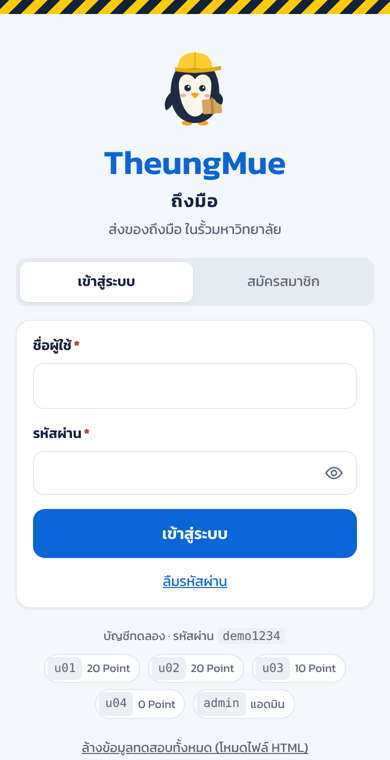
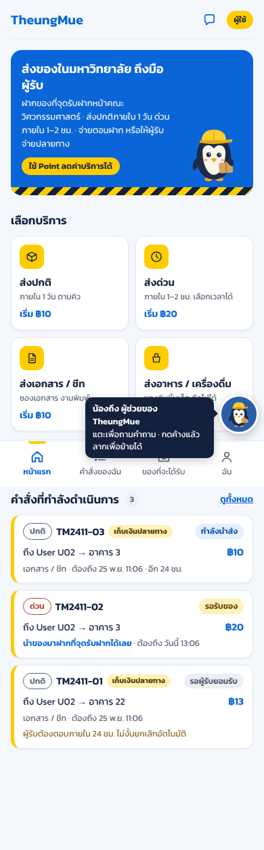
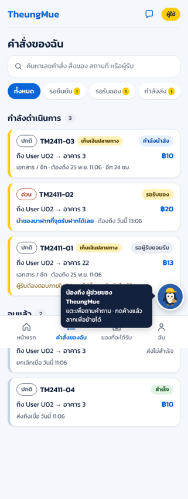
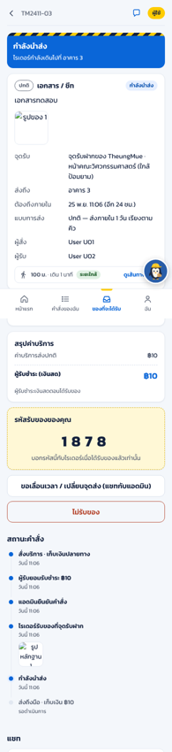
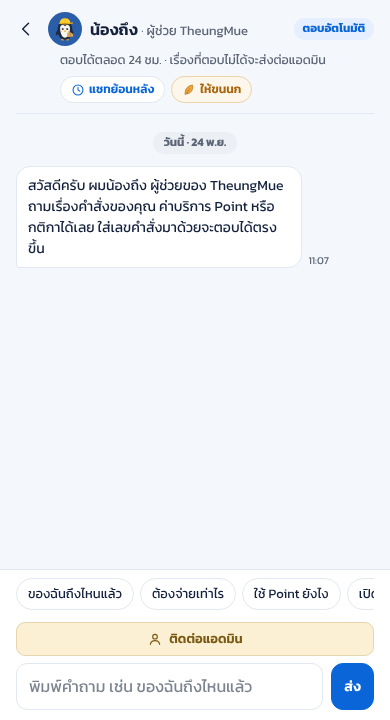
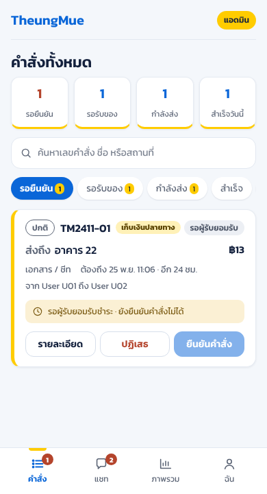
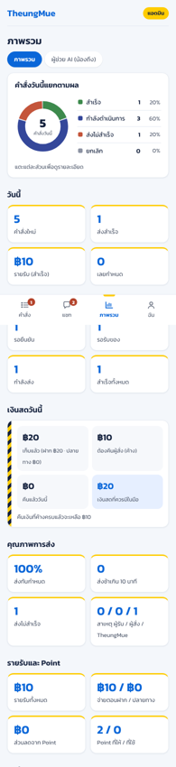

# TheungMue (ถึงมือ)

บริการรับส่งของภายในมหาวิทยาลัย ผู้ใช้นำของมาฝากที่จุดรับฝากหน้าคณะวิศวกรรมศาสตร์ ไรเดอร์ของ TheungMue เดินไปส่งถึงมือผู้รับในอาคารต่างๆ พร้อมผู้ช่วย AI "น้องถึง" ตอบคำถามเรื่องสถานะ ราคา และกติกาได้ตลอด 24 ชั่วโมง

โครงงานรายวิชา BV401 AI-Driven Business Innovation

| | ลิงก์ |
|---|---|
| ระบบที่ใช้งานจริง | https://jiramonthon-j.github.io/theungmue/ |
| เว็บทดลอง (บัญชีตัวอย่าง) | https://jiramonthon-j.github.io/theungmue/demo/ |

เว็บทดลองมีบัญชีตัวอย่างให้ลองครบทุกบทบาท รหัสผ่าน `demo1234` (ผู้ใช้ `u01`–`u04`, แอดมิน `admin`) ข้อมูลเก็บในเบราว์เซอร์ของผู้ที่เปิดเท่านั้น ไม่ปนกับระบบจริง

## หน้าจอ

| เข้าสู่ระบบ | หน้าแรก | คำสั่งของฉัน | กำลังนำส่ง |
|---|---|---|---|
|  |  |  |  |

| น้องถึง | แอดมิน: คำสั่ง | แอดมิน: ภาพรวม |
|---|---|---|
|  |  |  |

แบบหน้าตาทั้งระบบ: [docs/images/design-theme3.png](docs/images/design-theme3.png)

## ความสามารถหลัก

**ผู้ใช้**
- สั่งส่งของ 4 บริการ (ปกติ ด่วน เอกสาร อาหาร) ระบบคิดราคาตามระยะเดินจากจุดรับฝากให้เอง
- ผู้รับไม่ต้องสมัครแอป ผู้สั่งกรอกชื่อและเบอร์ผู้รับ แล้วส่งรหัสรับของ 4 หลักกับลิงก์ติดตามให้ผู้รับทาง LINE หรือ SMS
- ผู้รับเปิดลิงก์ติดตามได้โดยไม่ต้องเข้าสู่ระบบ เห็นสถานะ รหัส ยอดที่ต้องเตรียม และรีวิวการส่งได้หลังได้รับของ
- ถ้าเบอร์ผู้รับตรงกับสมาชิก คำสั่งขึ้นใน "ของที่จะได้รับ" ของคนนั้น และใช้ Point ลดค่าปลายทางได้
- จ่ายตอนฝาก หรือเก็บเงินปลายทาง (ผู้สั่งยืนยันว่าผู้รับตกลงจ่าย ถ้าผู้รับไม่จ่าย ผู้สั่งจ่ายแทน)
- ส่งไม่สำเร็จเพราะผู้รับ: ของเก็บที่จุดรับฝาก 3 วัน กดส่งใหม่ได้ในราคาเดิม หรือมารับคืน ไม่มีบทลงโทษ
- ติดตามสถานะ แผนที่เส้นทาง
- สะสมและใช้ Point เป็นส่วนลด ชดเชย Point อัตโนมัติเมื่อส่งช้าเกินกำหนด
- แชทกับแอดมินแยกตามคำสั่ง
- สมัครต้องยอมรับประกาศความเป็นส่วนตัว (PDPA) บัญชีเดิมกดยอมรับครั้งเดียวตอนเข้าสู่ระบบ อ่านย้อนหลังได้ในโปรไฟล์
- เข้าสู่ระบบได้ทีละเครื่อง เข้าเครื่องใหม่แล้วเครื่องเดิมออกจากระบบพร้อมแจ้งเหตุผล (แอดมินเข้าได้หลายเครื่อง)

**แอดมิน**
- ยืนยัน ปฏิเสธ รับของ (ถ่ายรูป เก็บเงิน) นำส่ง ปิดงานด้วยรหัสจากผู้รับ หรือถ่ายรูปและบันทึกชื่อคนรับเมื่อผู้รับไม่มีรหัส
- ขั้นตอนติดต่อผู้รับ: โทรผู้รับ 2 ครั้ง ห่างกัน 5 นาที โทรผู้สั่งให้ช่วยตาม แล้วรอ 10 นาที (ไรเดอร์โทรจากเบอร์ส่วนตัว)
- จัดการกรณีส่งไม่สำเร็จ คืนเงิน ของรอรับคืน ยอดค้างชำระของผู้สั่ง
- ลบเบอร์ผู้รับอัตโนมัติเมื่อจบงานครบ 30 วัน ลิงก์ติดตามหมดอายุ 7 วันหลังจบงาน
- ภาพรวมรายวัน เงินสดที่ควรมีในมือ อัตราส่งได้ในรอบแรก รีวิวจากผู้รับ ดาวน์โหลดรายงาน CSV
- จัดการผู้ใช้ (รีเซ็ตรหัสผ่าน ระงับบัญชี) ตั้งราคาและอัตรา Point เอง

**ผู้ช่วย AI น้องถึง**
- กลุ่มสร้างเอง ไม่ใช้บริการ AI ภายนอก ข้อมูลไม่ออกนอกระบบ
- จำแนกคำถาม 20 ประเภทด้วย n-gram ตัวอักษร + TF-IDF + ความคล้ายแบบ cosine กับประโยคสอน 215 ประโยค
- ชุดทดสอบความแม่นยำแยกจากชุดสอน 62 ประโยค จำแนกถูก 62/62
- มั่นใจต่ำกว่า 60% ถามกลับ เรื่องที่ต้องใช้คนตัดสิน (ของเสียหาย คืนเงิน โต้แย้ง) ส่งต่อแอดมินทันที
- ผู้ใช้ให้คะแนนคำตอบได้ แอดมินดู "สมุดพกน้องถึง" และสอนประโยคใหม่ได้

## โครงสร้าง

```
src/
  logic.js        กติกาทั้งหมดของระบบ (ใช้ร่วมกันทั้งเว็บทดลองและเซิร์ฟเวอร์)
  bot.js          ผู้ช่วย AI น้องถึง
  app.js          หน้าเว็บ
  style.css       หน้าตา (ธีมฟ้าคราม-เหลือง ฟอนต์ Kanit)
  local-store.js  ที่เก็บข้อมูลแบบเว็บทดลอง (localStorage)
  gas-server.js   ที่เก็บข้อมูลแบบใช้จริง (Google Sheet + Google Drive)
build.js          รวมเป็นไฟล์เดียว
dist/TheungMue.html    เว็บทดลอง (เปิดได้ทันที)
dist/gas/Code.gs       โค้ดฝั่ง Apps Script
dist/gas/index.html    หน้าเว็บฝั่ง Apps Script (สำรอง เปิดจากลิงก์ /exec)
dist/web/index.html    หน้าเว็บใช้จริงบน GitHub Pages (สร้างเมื่อมี api-url.txt)
docs/             GitHub Pages: index.html ระบบจริง · demo/ เว็บทดลอง · images/ ภาพหน้าจอ
gas/              ตั้งค่า Apps Script สำหรับ clasp
tests/            ชุดทดสอบอัตโนมัติ (Playwright)
```

```
ผู้ใช้ / แอดมิน ──► หน้าเว็บ GitHub Pages (docs/index.html)
                         │  fetch POST (ไม่แนบบัญชี Google ของผู้เปิด)
                         ▼
                    Web App Apps Script /exec
                     doPost() ──► apiCall() ──► logic.js ──► Google Sheet (1 ตาราง = 1 แท็บ)
                                                         └─► Google Drive (รูปของ)
```

หน้าเว็บอยู่บน GitHub Pages เพราะลิงก์ `/exec` ของ Apps Script เปิดไม่ได้ในเบราว์เซอร์ที่ล็อกอิน Google หลายบัญชี

## วิธีใช้งาน

```bash
npm install            # ติดตั้ง Playwright สำหรับรันทดสอบ
npm run build          # สร้าง dist/
npm test               # ทดสอบเว็บทดลอง
npm run test:gas       # ทดสอบผ่านโค้ด Apps Script จริงบน Google Sheet จำลอง
```

ติดตั้งระบบจริงบน Google Apps Script: ดู [DEPLOY.md](DEPLOY.md)

## การทดสอบ

| ชุดทดสอบ | จำนวนข้อ |
|---|---|
| ผู้ใช้ + แอดมิน (ขั้นตอนหลัก) | 45 |
| ผู้รับไม่ต้องสมัคร · เก็บเงินปลายทาง · ลิงก์ติดตาม · ส่งใหม่ | 36 |
| ผู้ช่วย AI น้องถึง | 25 |
| คะแนนคำตอบ / แชทรายวัน | 14 / 12 |
| ของที่จะได้รับ / คำสั่งของฉัน / ประวัติ Point / popup | 9 / 9 / 3 / 3 |
| ช่องโหว่ฝั่งผู้ใช้ / แอดมิน | 20 / 21 |
| ย้ายจุดรับฝาก / เวลาให้บริการ | 7 / 12 |
| เข้าสู่ระบบได้ทีละเครื่อง / ประกาศความเป็นส่วนตัว | 8 / 8 |
| **รวม** | **232** |

ทุกชุดรันได้ 2 โหมด: เว็บทดลอง และโค้ดเซิร์ฟเวอร์ `gas-server.js` บน Google Sheet จำลอง (`tests/gas/gasmock.js`) ที่เลียนพฤติกรรมของ Sheet จริง เช่น แปลงตัวเลขและวันที่เอง อ่านข้อความที่ขึ้นต้นด้วย `=` เป็นสูตร และจำกัด 50,000 ตัวอักษรต่อช่อง ผลล่าสุดผ่าน 232/232 ทั้ง 2 โหมด และกวาดหน้าจอ 28 หน้าที่ 320–1280 px ไม่พบส่วนที่ล้นจอ

## เครดิต

- แผนที่: [Leaflet](https://leafletjs.com) (BSD-2-Clause) และ © ผู้ร่วมพัฒนา [OpenStreetMap](https://www.openstreetmap.org/copyright)
- ฟอนต์: [Kanit](https://github.com/cadsondemak/kanit) โดย Cadson Demak (SIL Open Font License 1.1)
- ไอคอนคนเดิน: Material Icons โดย Google (Apache License 2.0)
- มาสคอตเพนกวินและไอคอนอื่น: ออกแบบเองในโครงงานนี้
